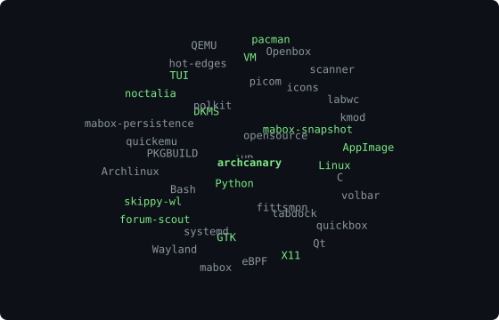
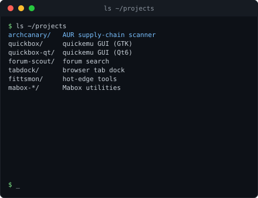
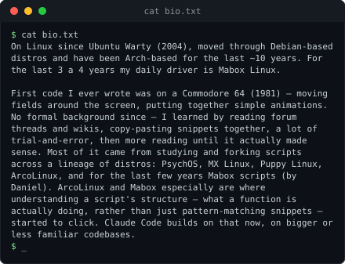

# musqz@linux ~ $ whoami

**Arch/Mabox tools: security, desktop utilities, VMs**

 

## `$ cat ~/.config/skills.list`

## `$ ls projects/`

### security/

| Project | Description | Stars |
|---|---|---|
| [archcanary](https://github.com/musqz/archcanary) | Layered AUR supply-chain scanner with systemd, eBPF and kmod auditing (Shell) |  |

### mabox/

| Project | Description | Stars |
|---|---|---|
| [mabox-snapshot](https://github.com/musqz/mabox-snapshot) | Create an ISO snapshot of a Mabox system (Python) |  |
| [mabox-persistence-usb](https://github.com/musqz/mabox-persistence-usb) | Create a persistence USB from a mabox-snapshot ISO (Python) |  |
| [mb-status-ce](https://github.com/musqz/mb-status-ce) | mb-status community edition (Shell) |  |
| [mabox-noctalia-ce](https://github.com/musqz/mabox-noctalia-ce) | Mabox Noctalia dots (Shell) |  |

### vm/

| Project | Description | Stars |
|---|---|---|
| [quickbox](https://github.com/musqz/quickbox) | GTK GUI for quickemu VMs: migration, snapshots, working dir (Python) |  |
| [quickbox-qt](https://github.com/musqz/quickbox-qt) | Qt6 GUI for quickemu (Python) |  |

### forums/

| Project | Description | Stars |
|---|---|---|
| [forum-scout](https://github.com/musqz/forum-scout) | GTK4 search tool for Arch-based forums and wikis (Python) |  |
| [forum-scout-qt](https://github.com/musqz/forum-scout-qt) | PyQt6 port of Forum Scout (Python) |  |

### desktop/

| Project | Description | Stars |
|---|---|---|
| [tabdock](https://github.com/musqz/tabdock) | X11/Wayland dock for Firefox-family browser tabs (Python) |  |
| [fittsmon-gui](https://github.com/musqz/fittsmon-gui) | GUI for FittsMon hot edges, X11 (Python) |  |
| [fittsmon-wl-gui](https://github.com/musqz/fittsmon-wl-gui) | Wayland variant of fittsmon-gui (Python) |  |
| [skippy-wl](https://github.com/musqz/skippy-wl) | Expose tool like skippy-xd, for Wayland (C) |  |
| [volbar](https://github.com/musqz/volbar) | Editable volume notifier, X11/GTK (Python) |  |
| [gparted-launch](https://github.com/musqz/gparted-launch) | Pick a drive, then open it in GParted (Shell) |  |
| [beautysolar-icon-theme](https://github.com/musqz/beautysolar-icon-theme) | BeautySolar icon theme, based on BeautyLine (Shell) |  |
| [betterlockscreen-theming](https://github.com/musqz/betterlockscreen-theming) | betterlockscreen theming (Shell) |  |

## `$ git remote -v`

Contributing upstream: skippy-xd, labwc, quickemu, noctalia.
